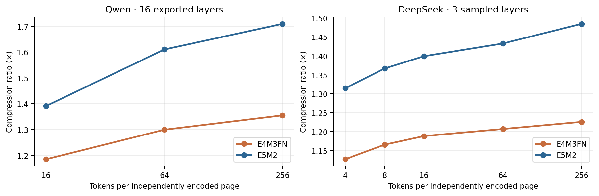
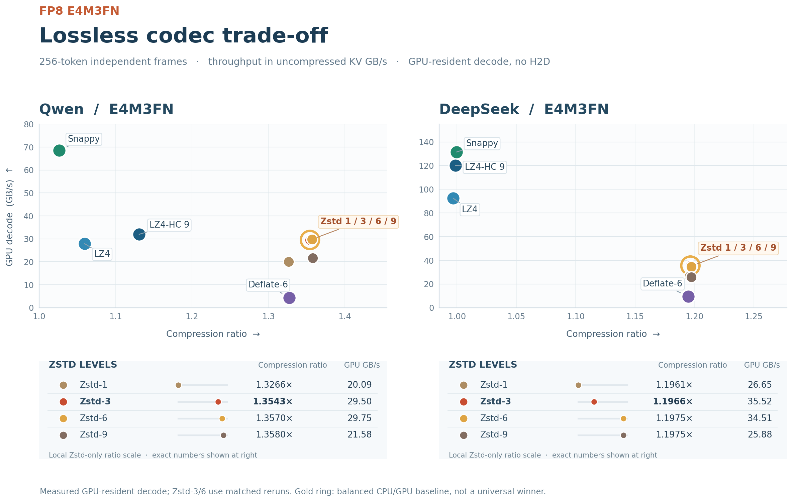
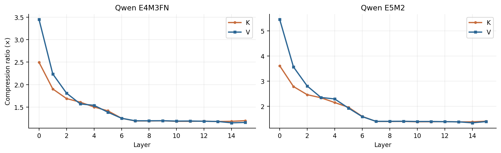
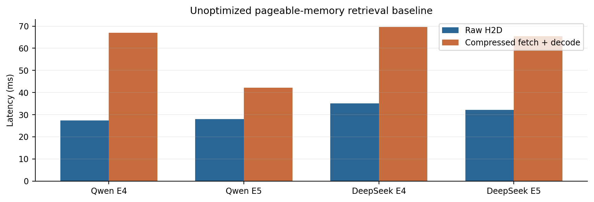

# Lossless Compression of FP8 KV Caches: What Actually Helps?

**A benchmark study of FP8 formats, chunk geometry, layer heterogeneity, and reversible transforms.**

*Research note · 9 November 2026 · RTX 5090 · Qwen / DeepSeek cache exports*

**Toward a shared benchmark suite.** We are planning an extensible, reproducible **lossless KV cache compression benchmark** covering **BF16, FP8 (E4M3FN/E5M2)** and additional formats. The suite is intended to work with **LMCache or other KV storage/serving backends**, helping practitioners compare codecs by compression ratio, CPU encoding cost, GPU decoding support, and real cache layout. **Suggestions, test cases and collaborations are welcome.**

> **At a glance.** FP8 KV remains compressible after quantization, but its compressibility depends strongly on storage layout and chunk size. Across the tested layouts, Zstd-3 is a practical CPU-encode/GPU-decode baseline; many extra transforms cost more than they save.

## Why this matters

Moving FP8 KV between GPU memory and an external tier still consumes significant storage and transport bandwidth. Lossless compression can shrink the bytes without changing any stored FP8 values, but high compression ratio is not enough: encoding latency, GPU decompression throughput, and the way KV data is grouped into independently readable frames all matter.

Our current study compares codec behavior on the **same FP8 payloads and a consistent measurement convention**, rather than claiming an LMCache production speedup. This analysis complements the proposals in [LMCache RFC #4498](https://github.com/LMCache/LMCache/issues/4498).

## TL;DR

- **Page geometry matters.** In the Qwen E4M3FN export, moving Zstd-3 from 16 to 256 tokens per independent page improves the raw payload ratio from 1.185× to 1.354×.
- **Compression varies by layer.** Early Qwen layers are much more compressible than later layers. That motivates group-aware compression policies, but it must be checked on independent requests.
- **A reversible transform is not free.** Channel-major reordering modestly improves some Qwen ratios but costs CPU preprocessing and GPU inverse-transform throughput; for the tested DeepSeek MLA-style data it adds little value.

## Measurement protocol

The exported Qwen data contains **16 K/V layers**, each with separate tensors of shape <code>[1, 4, 8192, 256]</code>. A 256-token page contains **512 KiB per layer** when K and V are encoded together. The exported DeepSeek data contains **43 shared-latent layers**, each shaped <code>[15095, 512]</code>; 256 tokens occupy **128 KiB per layer**. These are sample-specific shapes, not universal LMCache cache geometries.

We evaluate **E4M3FN and E5M2** without re-quantizing. Each layer-level token window is compressed independently. Reported compression ratios divide original FP8 payload bytes by codec payload bytes **plus 40 B of indexing per frame**; auxiliary scale data and full serving record descriptors are excluded. All reported codec outputs pass byte-exact recovery.

Throughput is computed from **uncompressed FP8 bytes / elapsed time**. CPU numbers use a single process with per-frame encoding. GPU figures use nvCOMP with compressed input, output buffers, and decoder configuration already resident and prepared on an RTX 5090; the timed scope includes GPU decompression and synchronization, but **excludes H2D/D2H transfers**. Qwen/DeepSeek E4M3FN Zstd-3 and Zstd-6 use three matched independent reruns and report medians; DeepSeek E5M2 Zstd-3 uses a separate three-run median. Other throughput figures come from previous runs.

## Finding 1 — Compression is sensitive to chunk size

*Figure 1. Qwen curves cover all 16 exported layers; DeepSeek curves use three sampled layers. The panels intentionally have distinct coverage and should not be treated as equal-sized experiments.*

For Qwen, 16 tokens per page correspond to 32 KiB of raw K+V per layer; for DeepSeek shared latent, they represent only 8 KiB. A larger independent frame allows the codec to exploit more local repetition, but it also increases the amount of KV to read and expand for a partial hit. Benchmarking only arbitrary 512-byte slices obscures that tradeoff.

## Finding 2 — Codec comparison: compression ratio vs. throughput

The following two tables report **raw (no preprocessing)** 256-token frames. Both CPU and GPU throughput use **uncompressed KV GB/s**. Brotli is included as a CPU-only baseline; no GPU throughput is inferred for it. The full eight-codec E4M3FN GPU comparison includes Zstd-6 and Snappy, which were additionally measured for this figure.

### Qwen3.8-27B
| FP8 | Codec | Ratio | CPU encode GB/s | GPU decode GB/s |
| --- | --- | --- | --- | --- |
| E4M3FN | Zstd-1 | 1.327× | 0.244 | 20.09 |
| E4M3FN | Zstd-3 | 1.354× | 0.217 | 29.50 |
| E4M3FN | Zstd-6 | 1.357× | 0.104 | 29.75 |
| E4M3FN | Zstd-9 | 1.358× | 0.118 | 21.58 |
| E4M3FN | Deflate-6 | 1.327× | 0.023 | 4.31 |
| E4M3FN | LZ4 | 1.060× | 0.505 | 27.89 |
| E4M3FN | LZ4-HC 9 | 1.131× | 0.036 | 31.96 |
| E4M3FN | Snappy | 1.026× | 0.782 | 68.60 |
| E4M3FN | Brotli 5 | 1.449× | 0.041 | CPU-only |
| E5M2 | Zstd-1 | 1.682× | 0.247 | 20.64 |
| E5M2 | Zstd-3 | 1.709× | 0.221 | 21.79 |
| E5M2 | Zstd-9 | 1.714× | 0.087 | 21.64 |
| E5M2 | Deflate-6 | 1.614× | 0.016 | 4.59 |
| E5M2 | LZ4 | 1.131× | 0.388 | 27.26 |
| E5M2 | LZ4-HC 9 | 1.235× | 0.041 | 31.42 |
| E5M2 | Brotli 5 | 1.809× | 0.052 | CPU-only |

### DeepSeek-V4-Flash
| FP8 | Codec | Ratio | CPU encode GB/s | GPU decode GB/s |
| --- | --- | --- | --- | --- |
| E4M3FN | Zstd-1 | 1.196× | 0.364 | 26.65 |
| E4M3FN | Zstd-3 | 1.197× | 0.375 | 35.52 |
| E4M3FN | Zstd-6 | 1.197× | 0.350 | 34.51 |
| E4M3FN | Zstd-9 | 1.197× | 0.373 | 25.88 |
| E4M3FN | Deflate-6 | 1.195× | 0.023 | 9.35 |
| E4M3FN | LZ4 | 0.997× | 0.689 | 92.32 |
| E4M3FN | LZ4-HC 9 | 0.999× | 0.045 | 120.16 |
| E4M3FN | Snappy | 1.000× | 1.865 | 131.44 |
| E4M3FN | Brotli 5 | 1.206× | 0.110 | CPU-only |
| E5M2 | Zstd-1 | 1.408× | 0.357 | 26.83 |
| E5M2 | Zstd-3 | 1.410× | 0.397 | 26.14 |
| E5M2 | Zstd-9 | 1.404× | 0.104 | 21.67 |
| E5M2 | Deflate-6 | 1.374× | 0.016 | 9.87 |
| E5M2 | LZ4 | 0.998× | 0.690 | 92.77 |
| E5M2 | LZ4-HC 9 | 1.009× | 0.045 | 78.27 |
| E5M2 | Brotli 5 | 1.416× | 0.107 | CPU-only |

Brotli-5 achieves **1.809× on Qwen E5M2** but with much slower CPU encoding than Zstd-3 and no measured GPU decompressor. LZ4-HC9 offers a modest improvement over LZ4 on Qwen at a substantial CPU cost, while both provide little or no compression on the tested DeepSeek payloads.
In a direct, matched **three-run comparison** on E4M3FN, Zstd-3 versus Zstd-6 GPU decoding gives **29.50 vs. 29.75 GB/s** on Qwen and **35.52 vs. 34.51 GB/s** on DeepSeek. Their GPU decode speeds are therefore comparable, not consistently better at level 6. Zstd-6 gains only ~0.20% in Qwen compression ratio while nearly halving CPU encoding throughput (**0.217 to 0.104 GB/s**). This is why **Zstd-3 remains a practical balanced default**, rather than claiming a universally optimal level based on one decoder timing.

*Figure 2. **E4M3FN only.** The upper panels plot eight GPU-decodable methods for each model. Four overlapping Zstd levels share a single family callout; their **exact, unshifted** ratios and GPU throughput are listed in the dedicated strips underneath, with a local ratio scale. Gold marks the balanced Zstd-3 baseline, not a universal optimum. Brotli has no measured GPU decoder and is excluded. All GPU rates exclude H2D/D2H.*

The published **FP8Lin** design in [LMCache PR #6128](https://github.com/LMCache/LMCache/pull/6128) is highly relevant to FP8 KV but is **not scored on these specific exports**: Qwen head dimension 256 and DeepSeek's shared-latent layout do not directly match the prototype's supported input layout. It would require a verified adaptation or compatible capture.

## Finding 3 — Compressibility is not uniform across layers

*Figure 3. Qwen Zstd-3, 256-token pages, K and V measured separately by layer. Early layers are often far more compressible. Zero-byte frequency in these exports is negligible, so trivial zero fill does not explain the pattern.*

A single global compression decision misses these differences. A future cache-aware policy could choose a codec or bypass compression per layer/group, but any such policy must account for the cost of metadata, extra CPU work, and GPU decompression. Our current cross-window test is not yet a cross-request validation.

## Finding 4 — How much do reversible transforms really improve compression?

The following **full-export Zstd-3** measurements include the change in compression ratio relative to the raw layout (percentage change in the **ratio**, not additional storage reduction). CPU encoding includes preprocessing, and GPU throughput includes the inverse transform. All methods use 256-token pages.

| Capture | FP8 | Preprocessing | Ratio | Δ vs. raw | CPU GB/s | GPU decode + inverse GB/s |
| --- | --- | --- | --- | --- | --- | --- |
| Qwen | E4M3FN | None (raw) | 1.354× | — (baseline) | 0.201 | 21.33 |
| Qwen | E4M3FN | Channel-major | 1.368× | **+1.02%** | 0.212 | 11.41 |
| Qwen | E4M3FN | Sign-byte remap | 1.354× | +0.00% | 0.114 | 20.06 |
| Qwen | E4M3FN | FP8 field separation | 1.288× | -4.93% | 0.055 | 20.72 |
| Qwen | E4M3FN | Bitshuffle (8-byte) | 1.255× | -7.32% | 0.025 | 18.77 |
| Qwen | E5M2 | None (raw) | 1.709× | — (baseline) | 0.221 | 21.79 |
| Qwen | E5M2 | Channel-major | 1.733× | **+1.37%** | 0.189 | 11.65 |
| Qwen | E5M2 | Sign-byte remap | 1.709× | +0.00% | 0.113 | 20.27 |
| Qwen | E5M2 | FP8 field separation | 1.483× | -13.26% | 0.054 | 21.13 |
| DeepSeek | E4M3FN | None (raw) | 1.197× | — (baseline) | 0.473 | 27.57 |
| DeepSeek | E4M3FN | Channel-major | 1.196× | -0.08% | 0.317 | 20.02 |
| DeepSeek | E4M3FN | Sign-byte remap | 1.197× | +0.00% | 0.144 | 24.41 |
| DeepSeek | E4M3FN | FP8 field separation | 1.030× | -13.96% | 0.060 | 25.46 |
| DeepSeek | E5M2 | None (raw) | 1.410× | — (baseline) | 0.397 | 26.14 |
| DeepSeek | E5M2 | Channel-major | 1.406× | -0.24% | 0.312 | 20.04 |
| DeepSeek | E5M2 | FP8 field separation | 1.108× | -21.40% | 0.057 | 23.91 |

The **compression-ratio uplift** is modest even in the best case: Qwen E4M3FN improves from 1.354× to 1.368× (**+1.02%**) with channel-major layout, and Qwen E5M2 from 1.709× to 1.733× (**+1.37%**). Both changes reduce GPU decode + inverse throughput from about 21–22 GB/s to about 11–12 GB/s. Channel-major does **not** improve the two DeepSeek formats. Sign-byte remapping is almost neutral for ratio, while FP8 sign/exponent/mantissa field separation worsens Zstd-3 ratios on these raw captures.

The full-export GPU runs also include **bitshuffle** for Qwen E4M3FN, where it reduces the Zstd-3 ratio from 1.354× to 1.255× (**−7.32%**) and GPU decode+inverse throughput from 21.33 to 18.77 GB/s. Other full-export format/method combinations were not all run (in particular, DeepSeek E5M2 sign-byte remapping); missing rows are **not measurements**. We screened additional transforms (anchor XOR, token/channel reordering, and KV regrouping) on limited layers: the 130-case sampled-layer CPU matrix will be included with the future reproducible benchmark release; those sampled numbers are not mixed into the full-export GPU table.

## Does faster GPU decoding imply faster retrieval?

*Figure 4. In an unoptimized pageable-DRAM measurement, packed H2D + nvCOMP setup + GPU decode was slower than a single raw H2D. The setup differs from GDS/RDMA and from LMCache's production serving pipeline; these numbers establish a caution, not a conclusion about those paths.*

This is why the RFC benchmark should distinguish codec throughput from real transfer latency, while first-party integration work should evaluate the end-to-end pipeline once layout, frame descriptors, GPU staging, and synchronization are defined.

## Reproducibility and limitations

- Only the exported data available for this experiment is evaluated, not multiple independent prompts or all production layers.
- FP8 payload bytes were verified exactly. Existing scales are retained separately; full-record/scale-inclusive ratios remain future work.
- Logical 256-token windows are not guaranteed to equal LMCache's effective chunk size for every heterogeneous KV group.
- CPU timing is sensitive to worker count and Python-level page preparation; GPU-resident decode excludes host transfers, storage I/O and serving contention.
- FP8Lin and other specialized methods must meet the same correctness, layout and GPU-backend requirements before entering the common GPU table.

## Next steps

We plan to align the benchmark with the LMCache GPU decompression record format and codec APIs, obtain independent KV traces for train/test separation, and evaluate real L2 retrieval. **No additional preprocessing is being introduced for the three new baselines.**

For coordination, see [LMCache RFC #4498](https://github.com/LMCache/LMCache/issues/4498) and the Zstd/portable-record interface discussions in [#5479](https://github.com/LMCache/LMCache/pull/5479) and [#5480](https://github.com/LMCache/LMCache/pull/5480).
